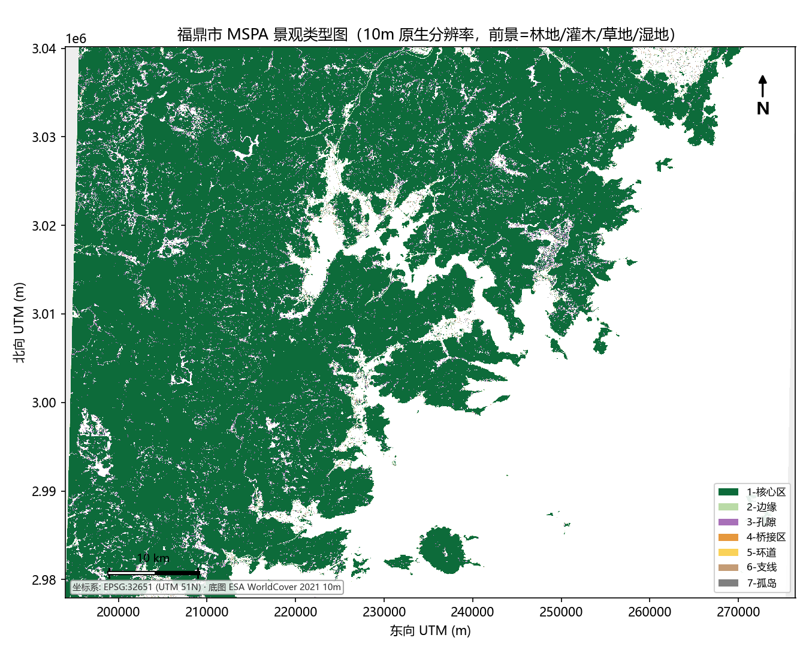
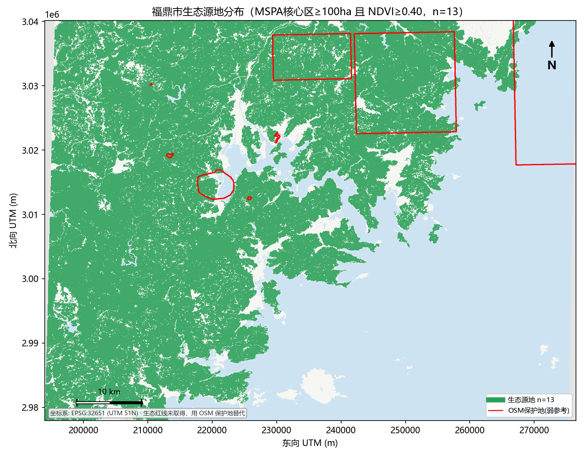
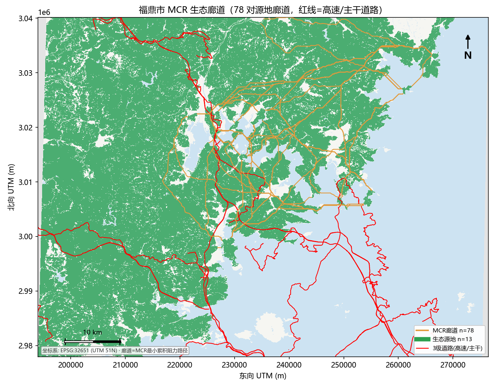
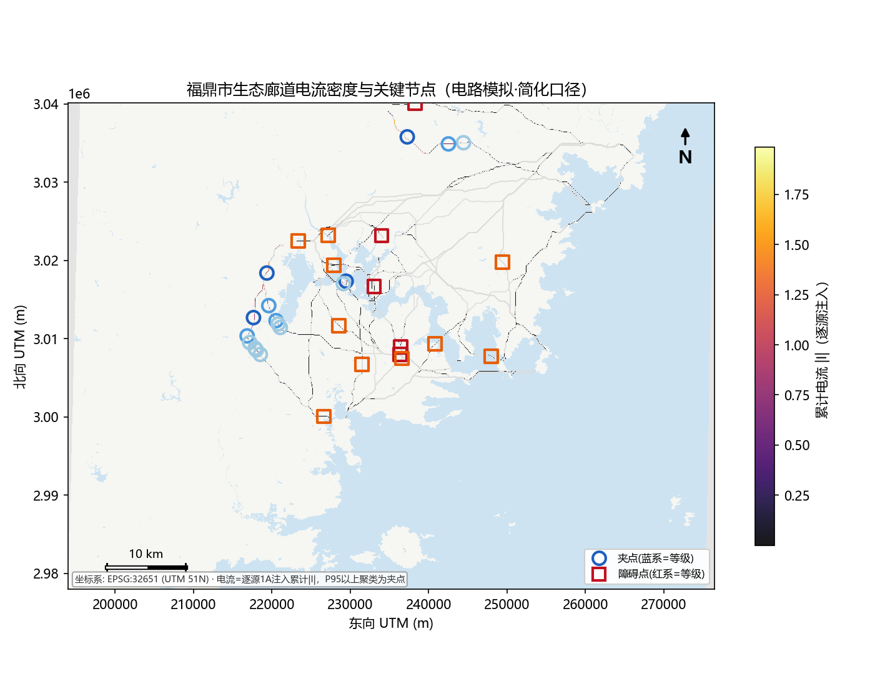
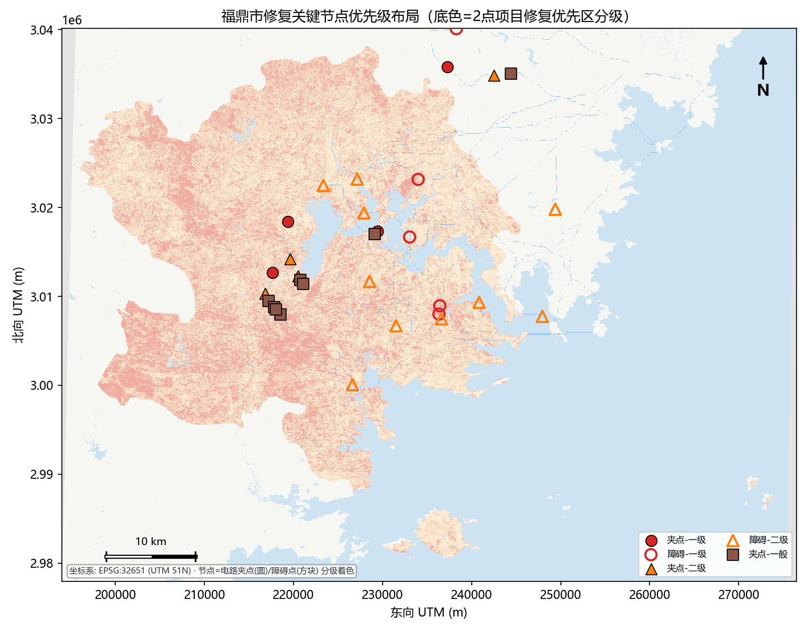

# 福鼎市生态网络构建与修复关键节点识别（MSPA + 电路理论）

> 一条夜跑自动化流水线跑完全部 9 个阶段：**生态廊道怎么连、连通瓶颈在哪、先修哪个节点**。
> 与姊妹项目《县域国土空间生态修复优先区识别》共享同一数据底座（同边界 / 同 30m 网格 / 同坐标系）——
> 那边回答"哪里退化重、先修哪里"（面），本项目回答"怎么连、先修哪个节点"（线与点），结论可互相叠加校验。
>
> 📍 在线结果图库：<https://dingdjfjs-star.github.io/fuding-eco-network/>
> 所有数字均可溯源到 `results/tables/*.json` 对应字段。

## 成果速览

| 指标 | 数值 |
|---|---|
| 研究区 | 福鼎市（闽浙交界，陆域 1611.0 km²），30m 网格 2748×2074，EPSG:32651 |
| 生态源地 | **13 个**（2 巨型 182,614 / 69,237 ha + 11 卫星斑块 100~984 ha，NDVI 0.648~0.79） |
| MCR 廊道 | **78 对全提取**，总长 **1512.8 km**（平均 19.4 km，最长 59.2 km） |
| 电路夹点 | **16 个**（一级 4）——生态流"必经之地" |
| 障碍点 | **15 个**（一级 5）——恢复增量法，最高单点增益 **51.5%** |
| 修复优先级 | 31 节点全排序 + 分措施决策表；5/31 命中姊妹项目一级优先区 |

## 方法链（五步）

```
① MSPA 源地        ② 阻力面           ③ MCR 廊道            ④ 电路理论节点            ⑤ 修复优先级
形态学七分类        5因子 max 融合      虚拟超级源 Dijkstra    廊道网络电路模拟           节点×优先区×工程措施
核心≥100ha+NDVI≥0.4 → base/low/high   → 78 对路径+敏感性     → 16 夹点 + 15 障碍点      → 31 节点决策表
```

- **MSPA（Python 自研简化口径）**：WorldCover 林/灌/草/湿地作前景，**10m 原生分辨率**七分类——做过 30m-mode 对比实验，mode 聚合会把窄谷"投票吞掉"造成假连通（核心区虚占 88%）；核心区 ≥100 ha 且 NDVI≥0.40 才计为源地。
- **阻力面**：土地利用 + 坡度 + 道路（指数衰减场 λ=300m）+ 居民点 + 水系五因子，**max 融合**（最差一票否决，保守可解释）；敏感性方案 low/high（道路/居民点阻力 ×0.5 / ×2）。
- **MCR 最小累积阻力**：560 万节点稀疏图（8 邻接），逐源虚拟超级源 + Dijkstra，predecessor 回溯出 78 对源地廊道；敏感性用同对廊道 90m 缓冲 **Jaccard 重合率**度量（low 0.423 / high 0.412，长度变化 −0.2% / +5.0%——骨架稳、线位随阻力参数可动）。
- **电路理论（廊道网络简化口径）**：在已提取的 18163 节点廊道网络上构建稀疏拉普拉斯系统，逐源注入 1A、其余源地接地（Dirichlet 零电压），spsolve 求电压场——**电流密度 = 生态流强度**，P95 以上聚类为夹点；障碍点用**恢复增量法**：廊道沿线耕地/建成区/裸地窗口"恢复成林地"后重算 MCR，降幅 top15 即修复收益最大的位置。全景观 Circuitscape 能发现廊道外备选路径，本口径夹点偏保守（漏报比虚报安全，已如实写入局限）。
- **修复优先级**：节点等级 × 姊妹项目优先区叠加 × 障碍增益 × 退化度 × 保护地邻近 → 措施决策表（道路节点→动物通道改造；农地/茶园节点→缓冲带改造；裸地→客土复绿；滨海湿地→退养还湿）。

## 成果图（results/figures，均含图例/比例尺/指北针/图题/坐标系）

| 图 | 内容 |
|---|---|
|  | **MSPA 七类景观类型**（10m 原生分辨率）：核心区 2612.8 km² 占前景 94.5%，桥接/环道=0（WorldCover 园地口径所致，见局限） |
|  | **13 个生态源地**："两大核心 + 11 卫星"格局，2 处与 OSM 保护地相交 |
|  | **78 对 MCR 廊道**（橙线）叠加高速/主干道路（红线）——廊道与道路的交锋带即阻力热点 |
|  | **电流密度与关键节点**：16 夹点（蓝圈，蓝深=等级高）+ 15 障碍点（红方块） |
|  | **修复优先级布局**：节点分三级着色，底色为姊妹项目修复优先区分级，空间互证 |

## 快速复现

```bash
pip install -r requirements.txt   # numpy / rasterio / scipy / pyproj / shapely / matplotlib

python scripts/s1_data_prep.py    # 数据准备：复用栅格一致性断言 + 矢量烧录
python scripts/s2_mspa.py         # MSPA 源地（--reuse 复用形态学中间结果）
python scripts/s3_resistance.py   # 五因子阻力面 + low/high 敏感性方案
python scripts/s4_mcr.py          # MCR 78 对廊道
python scripts/s4b_save_paths.py  # 逐对路径落盘 corridor_paths.npz
python scripts/s5_nodes.py        # 电路模拟夹点 + 恢复增量障碍点
python scripts/s6_priority.py     # 修复优先级排序 + 措施决策表
python scripts/s7_report.py       # 从 results/tables/*.json 重新生成报告
```

全流程**确定性**（无随机数参与），同输入逐位复现。脚本顶部的本地路径改为你的数据目录即可。

### 数据底座（复用姊妹项目，需先行准备）

`s1_data_prep.py` 顶部 `PRI` 指向姊妹项目数据根，要求以下文件（均为免费公开数据）：

```
<姊妹项目根>/
├─ results/tables/grid_spec.json     # 网格规格（2748×2074 @30m，EPSG:32651）
├─ results/rasters/                   # 统一到同一 30m 网格
│   wc30_mode.tif            ESA WorldCover 2021 众数重采样
│   slope30.tif              Copernicus GLO-30 DEM 坡度
│   flowacc30.tif            DEM 汇流累积
│   fuding_dem30_utm51n.tif  DEM（UTM51N）
│   ndvi2025_30m.tif         NDVI
│   dim_degradation30.tif    退化度（姊妹项目产出）
│   priority_class30.tif     修复优先区分级（姊妹项目产出）
└─ data/osm/
    roads.geojson  villages.geojson  reserves.geojson   # OSM 道路/居民点/保护地
```

原始数据获取方式：Copernicus GLO-30（AWS 公开桶 1° 瓦片直下）、ESA WorldCover 2021 v200（S3 公开桶）、OSM（Overpass API 多镜像）。`s1` 会对 7 个复用栅格做 CRS/尺寸/transform 三重断言，错位直接报错拒绝运行。

### 换一个县

只改三处：行政边界 adcode（DataV GeoAtlas）、网格规格、阻力档位——清单见 [docs/小白学习手册.md](docs/小白学习手册.md)。

## 工程踩坑（12 项全留痕，完整见 [docs/夜跑日志.md](docs/夜跑日志.md)）

| 坑 | 根因 | 修复 |
|---|---|---|
| 矢量烧录 0 像元 | GeoJSON 经纬度 vs UTM 网格，rasterize 不自动重投影 | pyproj 逐要素重投影 + 非零像元断言 |
| MSPA 核心虚占 88%、桥接=0 | 30m mode 聚合把窄谷"投票吞掉"造成假连通 | 换 10m 原生分辨率，v1 留作对比实验 |
| MCR 78 对全退化成 1 像元 | 虚拟超级源一次接了全部源地 | 每次只接当前源 |
| 修复后仍全场 inf | scipy CSR 稀疏加法削掉显式 0 权边 → 虚拟源孤岛 | 边权加 ε=1e-3 |
| 障碍点增益全 0 | 窗口选廊道对用了全廊道命中数而非窗口内命中 | 按窗口内路径像元数选对 |
| 渲染三连：漂白/品红/电流隐形 | ID 归一化色带端点、ListedColormap 整数元组、hot_r 0 端白色 | 固定色标 + inferno + 阈值显示 |

## 局限（如实报告）

1. **WorldCover 园地口径**：茶园归树冠覆盖 → 前景过连（桥接=0）；滩涂归水体 → 源地缺滩涂。有三调/国土变更调查数据应重跑 MSPA；
2. **电路为廊道网络简化口径**：全景观 Circuitscape 才能发现"廊道外"备选路径，本口径夹点位置偏保守；
3. **障碍点非全网格扫描**：候选来自廊道沿线耕地/建成区/裸地窗口的 top15 增量重算；
4. **阻力赋值多为经验值**：敏感性分析已量化其影响（Jaccard 0.42），但绝对量级未经实测验证；
5. **连通性视角 ≠ 工程可行性**：未考虑用地权属、资金、施工窗口；措施为方向性建议；
6. 无野外验证：廊道/节点位置未做实地核查（下一步第一项：20~30 个验证点）。

## 目录结构

```
├─ scripts/            s1~s7 流水线 + carto 制图工具 + 探针脚本
├─ results/
│  ├─ figures/         5 张成果图
│  ├─ rasters/         MSPA/阻力面/廊道/节点等结果栅格（30m GeoTIFF）
│  └─ tables/          各阶段溯源 JSON + 节点 GeoJSON + 逐对路径 npz
├─ report/             项目报告（md 自动生成 + docx 排版版）
├─ docs/               小白学习手册 / 分阶段设计文档 / 测验题 / 开发日志（12 踩坑）
├─ index.html          在线结果图库（GitHub Pages 首页）
└─ requirements.txt
```

## 姊妹项目

- **县域国土空间生态修复优先区识别**：同一数据底座上的"面"上诊断（哪里退化重、先修哪里），其一级优先区与本项目 31 个节点空间命中 5 个——两个项目结论互相印证。
- **福鼎沿海滩涂光伏选址**：同城的能源基础设施选址姊妹篇，<https://github.com/dingdjfjs-star/tidal-flat-pv-siting>
